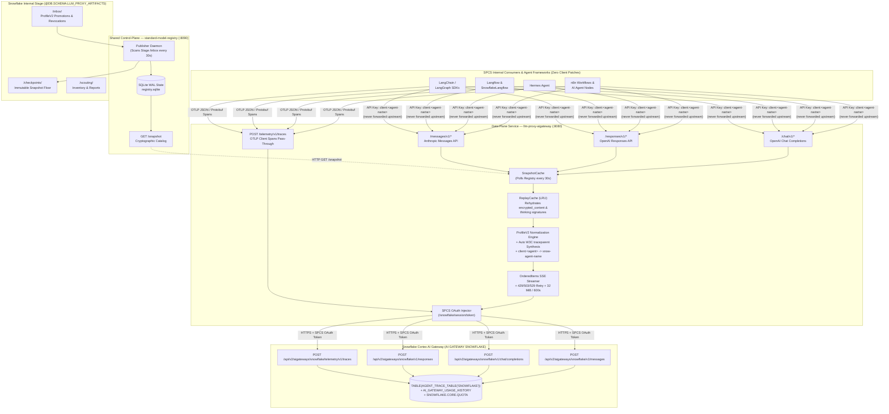
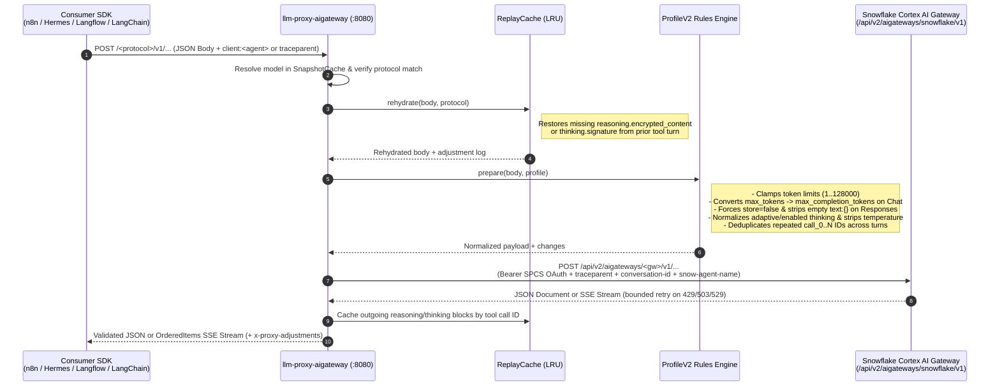
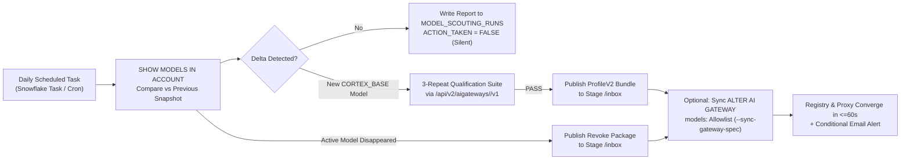

<div align="center">

# Snowflake Cortex AI Gateway — Universal LLM Proxy & Autonomous Model Registry

**Protocol-Validating SPCS Data-Plane, Native OpenTelemetry Trace Correlation, OTLP Pass-Through & Zero-Touch Model Governance for Snowflake Cortex AI Gateway**

[-success?style=for-the-badge)](LICENSE)
[](pyproject.toml)
[](https://docs.snowflake.com/en/user-guide/snowflake-cortex/ai-gateway)
[](#3-protocol--telemetry-surface-8080--8090)
[](#8-quickstart--offline-verification)

</div>

---

> [!WARNING]
> ### IMPORTANT DISCLAIMER — NOT AN OFFICIAL SNOWFLAKE PRODUCT
> **This repository is an independent, open-source community and field-engineering reference implementation** built on top of **[Snowflake Cortex AI Gateway](https://docs.snowflake.com/en/user-guide/snowflake-cortex/ai-gateway)** (`/api/v2/aigateways/<gateway>/v1`) and **[Snowpark Container Services (SPCS)](https://docs.snowflake.com/en/developer-guide/snowpark-container-services/overview)**.
> - It is **NOT an official Snowflake Inc. product** and is **NOT part of the commercial Snowflake service offering**.
> - It carries **NO official Snowflake SLA, warranty, or technical support commitment**.
> - It is provided strictly **"AS IS"** under the permissive **[MIT License](LICENSE)** (**100% free and open-source**). Always review and validate security, governance, and compliance requirements in your own Snowflake environment before deploying to production.

> [!NOTE]
> ### DUAL-TRACK ARCHITECTURE & COMPANION REPOSITORY
> This repository is maintained in lockstep with **[`snowflake-proxy-cortexrestapi`](https://github.com/fbattaglieri-snowflake/snowflake-proxy-cortexrestapi)**:
> - **[`snowflake-proxy-cortex-aigateway`](https://github.com/fbattaglieri-snowflake/snowflake-proxy-cortex-aigateway)** *(this repository)* — Routes inference through **Snowflake Cortex AI Gateway** (`/api/v2/aigateways/<gateway>/v1`) with centralized model allowlists, OpenTelemetry server spans (`TABLE(AGENT_TRACE_TABLE('<GATEWAY>'))`), OTLP client trace pass-through (`POST /telemetry/v1/traces`), automatic W3C `traceparent` + `snow-agent-name` attribution, `AI_GATEWAY_USAGE_HISTORY` accounting, and blocking per-user `SNOWFLAKE.CORE.QUOTA` enforcement.
> - **[`snowflake-proxy-cortexrestapi`](https://github.com/fbattaglieri-snowflake/snowflake-proxy-cortexrestapi)** — Routes inference directly to the **Snowflake Cortex REST API** (`/api/v2/cortex/v1`) with the exact same `ProfileV2` normalization engine, `OrderedItems` SSE stream stabilizer, `ReplayCache` multi-turn rehydration, bounded `HTTP 429/503/529` backoff, and autonomous daily scouting pipeline.
> - **Zero-Extra-Cost Co-Hosting:** Both proxies validate and share the exact same **Single-Writer Model Registry (`:8090`)** via `_equivalent_snowflake_upstream` on a single `CPU_X64_XS` compute pool.

---

## Table of Contents

1. [Why Put This Proxy in Front of Snowflake Cortex AI Gateway?](#1-why-put-this-proxy-in-front-of-snowflake-cortex-ai-gateway)
2. [Cortex AI Gateway Proxy vs. Cortex REST API Proxy](#2-cortex-ai-gateway-proxy-vs-cortex-rest-api-proxy)
3. [End-to-End Visual Architecture](#3-end-to-end-visual-architecture)
4. [Protocol & Telemetry Surface (`:8080` & `:8090`)](#4-protocol--telemetry-surface-8080--8090)
5. [Request Normalization, Streaming & Multi-Turn `ReplayCache` Pipeline](#5-request-normalization-streaming--multi-turn-replaycache-pipeline)
6. [Native OpenTelemetry, OTLP Client Spans & Governance in Cortex AI Gateway](#6-native-opentelemetry-otlp-client-spans--governance-in-cortex-ai-gateway)
7. [Autonomous Daily Model Scouting, Qualification & Zero-Touch Promotion](#7-autonomous-daily-model-scouting-qualification--zero-touch-promotion)
8. [Repository Structure](#8-repository-structure)
9. [Quickstart & Offline Verification](#9-quickstart--offline-verification)
10. [Official Snowflake Documentation References](#10-official-snowflake-documentation-references)
11. [License & Legal Disclaimer](#11-license--legal-disclaimer)

---

## 1. Why Put This Proxy in Front of Snowflake Cortex AI Gateway?

**[Snowflake Cortex AI Gateway](https://docs.snowflake.com/en/user-guide/snowflake-cortex/ai-gateway)** (`https://<account-host>/api/v2/aigateways/<gateway-name>`) provides account-level model allowlists, OpenTelemetry server traces (`TABLE(AGENT_TRACE_TABLE('<GATEWAY>'))`), OTLP client trace ingestion (`/telemetry/v1/traces`), usage attribution (`SNOWFLAKE.ACCOUNT_USAGE.AI_GATEWAY_USAGE_HISTORY`), and blocking per-user `SNOWFLAKE.CORE.QUOTA` limits.

However, when connecting standard agentic frameworks and workflow platforms (**n8n**, **Hermes Agent**, **Langflow**, **Native-Snowflake-Langflow**, **LangChain / LangGraph**) inside **Snowpark Container Services (SPCS)**, **Cortex AI Gateway alone is not sufficient**:

| Capability Gap on Raw Cortex AI Gateway | How `snowflake-proxy-cortex-aigateway` Solves It |
|---|---|
| **1. No `/v1/models` Discovery Endpoint** (`GET /api/v2/aigateways/snowflake/v1/models` returns `HTTP 404: Not a supported AI Gateway path`) | Exposes native `GET /chat/v1/models`, `GET /responses/v1/models`, and `GET /messages/v1/models` backed by the **Single-Writer Model Registry (`:8090`)**, returning only models cryptographically qualified for each exact protocol (e.g., keeping Claude models on `/messages` because AI Gateway rejects Claude on `/v1/chat/completions`). |
| **2. Strict Upstream Parameter Rejections (`HTTP 400`)** (`store=true` and `text={}` from n8n, `max_tokens` instead of `max_completion_tokens` on `openai-gpt-6-luna`, Claude 5.x `adaptive` thinking + `temperature` conflicts, string `tool_choice="auto"` on Messages) | **`ProfileV2` Normalization Engine (`rules.py`)** transparently rewrites, clamps (`1..128000`), upgrades small client token defaults (`32768` on mandatory-adaptive Claude 5.x), or strips incompatible hints before forwarding to Cortex AI Gateway, recording every change in `x-proxy-adjustments`. |
| **3. Interleaved SSE Events on OpenAI Responses** (`response.output_item.added` with provisional/empty `encrypted_content`) | **`OrderedItems` Stream Stabilizer (`stream_order.py`)** serializes SSE output items, validates final `encrypted_content`, and backfills `response.output_item.added` so `langchain-openai`, `Langflow`, `Hermes`, and `n8n` never fail mid-stream. |
| **4. Stateless Clients Dropping `encrypted_content` or `thinking.signature`** on Multi-Turn Tool Loops | **In-Memory `ReplayCache` (`replay_cache.py`)** caches reasoning/thinking artifacts keyed by `call_id` / `tool_use_id` and rehydrates them automatically on subsequent tool-result turns. |
| **5. SPCS Rotating OAuth, W3C Trace Synthesis & Zero-Header Agent Tagging** | Injects the rotating SPCS OAuth token (`/snowflake/session/token`), synthesizes a valid W3C `traceparent` (`00-<32hex>-<16hex>-01`) whenever omitted by SDKs/n8n, maps `client:<agent-name>` API keys into `snow-agent-name` without leaking credentials upstream, and retries transient `HTTP 429/503/529` responses across a 100s backoff window. |

---

## 2. Cortex AI Gateway Proxy vs. Cortex REST API Proxy

| Dimension | `snowflake-proxy-cortex-aigateway` *(This Repo)* | [`snowflake-proxy-cortexrestapi`](https://github.com/fbattaglieri-snowflake/snowflake-proxy-cortexrestapi) |
|---|---|---|
| **Snowflake Upstream Endpoint** | `https://<host>/api/v2/aigateways/<gateway>/v1` | `https://<host>/api/v2/cortex/v1` |
| **Client Protocol Surfaces (`:8080`)** | `/messages/v1`, `/chat/v1`, `/responses/v1` + `POST /telemetry/v1/traces` | `/messages/v1`, `/chat/v1`, `/responses/v1` |
| **Centralized Model Allowlist** | Enforced server-side via `ALTER AI GATEWAY <name> SET SPECIFICATION` | Governed by Registry catalog & `CORTEX_MODELS_ALLOWLIST` |
| **OpenTelemetry Spans & Payload Capture** | Native spans in `TABLE(AGENT_TRACE_TABLE('<GATEWAY>'))` + OTLP client spans | Not written to `AGENT_TRACE_TABLE` |
| **Usage & Cost Attribution View** | `SNOWFLAKE.ACCOUNT_USAGE.AI_GATEWAY_USAGE_HISTORY` | `SNOWFLAKE.ACCOUNT_USAGE.CORTEX_REST_API_USAGE_HISTORY` |
| **Blocking Per-User Quotas** | Supported via `SNOWFLAKE.CORE.QUOTA` (`ADD_SHARED_RESOURCE('AI GATEWAY')`) | Account/budget-level monitoring |
| **Privilege Model** | `USAGE` (invoke) / `MONITOR` (read traces) on `AI GATEWAY <name>` | `SNOWFLAKE.CORTEX_USER` or `SNOWFLAKE.CORTEX_REST_API_USER` |
| **`ProfileV2` + `OrderedItems` + `ReplayCache`** | Identical | Identical |
| **Shared `STANDARD_MODEL_REGISTRY (:8090)`** | Yes (`_equivalent_snowflake_upstream`) | Yes (`_equivalent_snowflake_upstream`) |

---

## 3. End-to-End Visual Architecture

### 3.1 High-Level Component & Data-Flow Diagram (Mermaid)



### 3.2 ASCII Deployment Topology Inside Snowpark Container Services

```text
+---------------------------------------------------------------------------------------------------+
| SNOWFLAKE ACCOUNT (CORTEX_ENABLED_CROSS_REGION = 'ANY_REGION' + AI GATEWAY SNOWFLAKE)             |
|                                                                                                   |
|  +-----------------------+   +-----------------------+   +-----------------------+                |
|  |     n8n Workflows     |   |     Hermes Agent      |   |  Langflow / LangChain |                |
|  |  (Anthropic / OpenAI) |   |  (3 Dynamic Providers)|   |   (Standard SDKs)     |                |
|  +-----------+-----------+   +-----------+-----------+   +-----------+-----------+                |
|              |                           |                           |                            |
|              +---------------------------+---------------------------+                            |
|                                          |  Internal SPCS DNS (*.svc.spcs.internal:8080)          |
|                                          |  API Key: "client:n8n-spcs" -> snow-agent-name         |
|                                          v                                                        |
|  +---------------------------------------------------------------------------------------------+  |
|  |                  DATA-PLANE: llm-proxy-aigateway (:8080)                                    |  |
|  |                                                                                             |  |
|  |  [GET  /<protocol>/v1/models] ---------> Serves strictly qualified models from SnapshotCache|  |
|  |  [POST /chat/v1/chat/completions] -----> ReplayCache -> ProfileV2 Rules -> OrderedItems SSE |  |
|  |  [POST /responses/v1/responses] -------> Synthesizes W3C traceparent when omitted, maps     |  |
|  |  [POST /messages/v1/messages]            conversation-id & snow-agent-name, retries 429/529 |  |
|  |  [POST /telemetry/v1/traces] ----------> Injects rotating /snowflake/session/token (OAUTH)  |  |
|  +--------------------+--------------------------------------------------+---------------------+  |
|                       | Polls /snapshot (30s)                            | HTTPS + SPCS OAuth     |
|                       v                                                  v                        |
|  +----------------------------------------+     +----------------------------------------------+  |
|  | SHARED CONTROL-PLANE:                  |     | SNOWFLAKE CORTEX AI GATEWAY                  |  |
|  | standard-model-registry (:8090)        |     | https://<host>/api/v2/aigateways/snowflake   |  |
|  |  - Single-Writer SQLite (PRAGMA FULL)  |     |  - /v1/messages                              |  |
|  |  - Shared with llm-proxy-standard      |     |  - /v1/chat/completions                      |  |
|  |  - Scans Stage /inbox every 30s        |     |  - /v1/responses                             |  |
|  +--------------------+-------------------+     |  - /telemetry/v1/traces (OTLP)               |  |
|                       ^                         |  - TABLE(AGENT_TRACE_TABLE('SNOWFLAKE'))     |  |
|                       | Stage Mount             |  - ACCOUNT_USAGE.AI_GATEWAY_USAGE_HISTORY    |  |
|  +--------------------+-------------------+     |  - SNOWFLAKE.CORE.QUOTA Enforcement          |  |
|  | INTERNAL STAGE (@...ARTIFACTS)         |     +----------------------------------------------+  |
|  |  /inbox       /checkpoints  /scouting  | <--- Daily Scouting Task + Gateway Allowlist Sync     |
|  +----------------------------------------+                                                       |
+---------------------------------------------------------------------------------------------------+
```

---

## 4. Protocol & Telemetry Surface (`:8080` & `:8090`)

| Surface | Service Port | HTTP Method & Path | Upstream Cortex AI Gateway Target | Purpose |
|---|---|---|---|---|
| **OpenAI Chat Completions** | `:8080` | `GET /chat/v1/models`<br/>`GET /chat/v1/models/{id}`<br/>`POST /chat/v1/chat/completions` | `POST /api/v2/aigateways/<gw>/v1/chat/completions` | Native Chat Completions discovery & inference |
| **OpenAI Responses API** | `:8080` | `GET /responses/v1/models`<br/>`GET /responses/v1/models/{id}`<br/>`POST /responses/v1/responses` | `POST /api/v2/aigateways/<gw>/v1/responses` | Native Responses discovery, `OrderedItems` SSE & `encrypted_content` replay |
| **Anthropic Messages API** | `:8080` | `GET /messages/v1/models`<br/>`GET /messages/v1/models/{id}`<br/>`POST /messages/v1/messages` | `POST /api/v2/aigateways/<gw>/v1/messages` | Native Anthropic Messages discovery, adaptive/extended thinking & signature replay |
| **OTLP Client Telemetry** | `:8080` | `POST /telemetry/v1/traces` | `POST /api/v2/aigateways/<gw>/telemetry/v1/traces` | Authenticated OTLP JSON/Protobuf client span ingestion (up to 1 MiB) |
| **Health & Readiness** | `:8080` | `GET /healthz`<br/>`GET /readyz` | Local check (SnapshotCache + SPCS token + drain state) | Container probes & active catalog `revision` inspection |
| **Model Registry Snapshot** | `:8090` | `GET /snapshot`<br/>`GET /readyz` | Local SQLite single-writer state | Signed catalog snapshot distribution to data-plane replicas |

---

## 5. Request Normalization, Streaming & Multi-Turn `ReplayCache` Pipeline



### Summary of Automatic Protocol Normalizations (`src/llm_proxy_standard/rules.py` & `app.py`)

| Protocol | Client Quirk / Incompatible Parameter | Automatic Proxy Action |
|---|---|---|
| **`chat`** | Client sends `max_tokens` alone (e.g. `openai-gpt-6-luna` rejects `max_tokens` with `HTTP 400`) | Automatically converts `max_tokens` &rarr; `max_completion_tokens` (`rename-max-tokens-to-completion`). |
| **`chat`** | Client sends both `max_tokens` and `max_completion_tokens` | Drops `max_tokens` and keeps `max_completion_tokens` (`dedup-max-tokens`). |
| **`chat`** | Model requires `reasoning_effort="none"` or forbids `reasoning_effort` | Forces `"none"` or strips `reasoning_effort` per the model's `ProfileV2` constraints. |
| **`responses`** | Client (e.g. n8n) sends `store: true`, `text: {}`, or `temperature` on reasoning models | Forces `store: false`, removes empty `text: {}`, strips unsupported `temperature`/`top_p`, and injects `include: ["reasoning.encrypted_content"]`. |
| **`responses`** | Streaming events arrive with provisional/empty `encrypted_content` on `output_item.added` | `OrderedItems` buffers per-item events, validates final `encrypted_content` equality, and backfills `output_item.added`. |
| **`messages`** | Claude 5.x models requiring or supporting `adaptive` thinking receive `thinking.type="enabled"` or small default `max_tokens` (`1024..4096`) | Normalizes `thinking` (`adaptive` + `output_config={"effort": "medium"}` where supported), upgrades small client defaults to `32768` on mandatory-adaptive models, strips conflicting `temperature`/`top_p`, and synthesizes missing `content_block_stop` frames on truncated streams. |
| **`messages`** | Client sends string `tool_choice: "auto"` instead of object | Rewrites to `{"type": "auto"}`. |
| **All Protocols** | Multi-round agent reuses `call_0` across closed turns | Renames duplicate IDs in subsequent turns (`call_0` &rarr; `call_0_r2`) in both assistant call and tool result. |
| **All Protocols** | Upstream transient `HTTP 429`, `503`, or `529` | Bounded 100s exponential retry (`3s, 7s, 15s, 30s, 45s`) honoring `Retry-After` / `x-ratelimit-reset-*` / `anthropic-ratelimit-*-reset` headers. |

---

## 6. Native OpenTelemetry, OTLP Client Spans & Governance in Cortex AI Gateway

### 6.1 End-to-End Trace Correlation (`traceparent` + `conversation-id` + `snow-agent-name`)

When a consumer calls `llm-proxy-aigateway (:8080)`, `_gateway_observability_headers()` validates and populates:
- **`traceparent`** (`^00-[0-9a-f]{32}-[0-9a-f]{16}-[0-9a-f]{2}$`): Forwarded when supplied by the client, or **synthesized automatically** (`00-<32hex>-<16hex>-01`) on inference requests when omitted by standard SDKs/n8n nodes so every span in `TABLE(AGENT_TRACE_TABLE('SNOWFLAKE'))` carries a full 128-bit W3C `trace_id`.
- **`tracestate`**: W3C vendor trace state.
- **`x-snowflake-ai-gateway-conversation-id`** (also mapped automatically from `x-claude-code-session-id` or `x-conversation-id`): populates `RECORD_ATTRIBUTES:"gen_ai.conversation.id"` in `AGENT_TRACE_TABLE`.
- **`snow-agent-name`**: Forwarded from `snow-agent-name` header, or **extracted automatically** when an internal consumer sets its credential API key to `client:<agent-name>` (e.g. `client:n8n-spcs`, `client:hermes-agent` — never sent upstream as an API key!), falling back to `PROXY_DEFAULT_AGENT_NAME`. Populates `RECORD_ATTRIBUTES:"http.request.header.snow-agent-name"`.

### 6.2 Internal OTLP Client Trace Pass-Through (`POST /telemetry/v1/traces`)

Internal SPCS services do not need static PATs to export OpenTelemetry client spans (tool execution latency, retrieval steps, or orchestrator spans). Point any standard OTLP HTTP exporter to:

```text
http://llm-proxy-aigateway.<namespace>.svc.spcs.internal:8080/telemetry/v1/traces
```

The proxy validates the OTLP payload (`application/json` or `application/x-protobuf`, up to `1 MiB`), attaches the rotating SPCS OAuth token from `/snowflake/session/token`, and forwards it to `https://<account-host>/api/v2/aigateways/<gateway>/telemetry/v1/traces`.

### 6.3 Querying Spans in `TABLE(AGENT_TRACE_TABLE('SNOWFLAKE'))`

```sql
SELECT
  TIMESTAMP,
  TRACE:"trace_id"::STRING AS TRACE_ID,
  RECORD:"name"::STRING AS SPAN_NAME,
  RECORD_ATTRIBUTES:"gen_ai.request.model"::STRING AS MODEL,
  RECORD_ATTRIBUTES:"gen_ai.conversation.id"::STRING AS CONVERSATION_ID,
  RECORD_ATTRIBUTES:"http.request.header.snow-agent-name"::STRING AS AGENT_NAME,
  RECORD_ATTRIBUTES:"gen_ai.usage.input_tokens"::INT AS INPUT_TOKENS,
  RECORD_ATTRIBUTES:"gen_ai.usage.output_tokens"::INT AS OUTPUT_TOKENS,
  RECORD_ATTRIBUTES:"http.response.status_code"::INT AS HTTP_STATUS
FROM TABLE(AGENT_TRACE_TABLE('SNOWFLAKE'))
WHERE TIMESTAMP >= DATEADD('hour', -24, CURRENT_TIMESTAMP())
ORDER BY TIMESTAMP DESC;
```

### 6.4 Gateway Specification, Usage History & Blocking Per-User Quotas (`SNOWFLAKE.CORE.QUOTA`)

```sql
-- 1. Inspect hourly token & request usage by model and caller
SELECT
  START_TIME,
  END_TIME,
  GATEWAY_NAME,
  MODEL_NAME,
  USER_ID,
  REQUEST_COUNT,
  INPUT_TOKENS,
  OUTPUT_TOKENS
FROM SNOWFLAKE.ACCOUNT_USAGE.AI_GATEWAY_USAGE_HISTORY
ORDER BY START_TIME DESC;

-- 2. Configure AI Gateway model allowlist, server trace logging & OTLP client telemetry
ALTER AI GATEWAY SNOWFLAKE SET SPECIFICATION
$$
schema_version: 1
models:
  - name: claude-opus-5-5
  - name: claude-sonnet-5-5
  - name: claude-haiku-5-5
  - name: openai-gpt-6-luna
  - name: openai-gpt-6.1-terra
  - name: openai-gpt-6-astra
  - name: grok-4.7
  - name: kimi-k3
logging:
  enabled: true
  enable_client_telemetry: true
  capture_payload:
    request_response: true
  exclude_tags:
    - sensitive_pii
$$;

-- 3. Enforce blocking per-user AI Credit / token quotas on Cortex AI Gateway
CREATE SNOWFLAKE.CORE.QUOTA ai_gateway_daily_quota
  LIMIT = 100
  REFRESH_INTERVAL = '1 day';

CALL ai_gateway_daily_quota!ADD_SHARED_RESOURCE('AI GATEWAY', 'SNOWFLAKE');
CALL ai_gateway_daily_quota!SET_MEMBER_LIMIT('USER', '<USERNAME>', 25);
```

---

## 7. Autonomous Daily Model Scouting, Qualification & Zero-Touch Promotion



See **[`docs/PROMOTION.md`](docs/PROMOTION.md)** for full instructions on running `scripts/daily_scout_and_promote.py`, `scripts/promote_model.py`, and `scripts/spcs_scout_worker.py`.

---

## 8. Repository Structure

```text
snowflake-proxy-cortex-aigateway/
├── Dockerfile                              # Hardened non-root container image (port 8080)
├── LICENSE                                 # MIT License + Non-Official Disclaimer
├── README.md                               # Architecture, visual diagrams, observability & usage
├── pyproject.toml                          # Python package metadata & pinned dependencies
├── requirements.runtime.lock               # Locked runtime dependencies
├── requirements.test.lock                  # Locked offline test dependencies
├── deployment/
│   ├── service-spec.yaml.template          # SPCS service specification template (Gateway mode)
│   ├── setup_daily_scout_task.sql.template # Snowflake DDL for autonomous daily scouting task
│   └── trust-empty.json                    # Baseline Registry trust configuration template
├── docs/
│   ├── ARCHITECTURE.md                     # Deep-dive on protocol normalization, Gateway headers & OTLP
│   ├── CONSUMERS.md                        # Client setup for n8n, Hermes, Langflow, LangChain + OTLP
│   └── PROMOTION.md                        # Zero-touch promotion, revocation & Gateway spec sync
├── examples/
│   └── standard_clients.py                 # Ready-to-run OpenAI, Anthropic, and LangChain client helpers
├── scripts/
│   ├── promote_model.py                    # Zero-touch model promotion & revocation CLI
│   ├── daily_scout_and_promote.py          # Daily account snapshot diff, qualification & Gateway spec sync
│   └── spcs_scout_worker.py                # In-container SPCS scouting job worker
├── src/
│   ├── llm_proxy_standard/                 # Core proxy (:8080) & Single-Writer Registry (:8090)
│   │   ├── app.py                          # FastAPI data-plane + Gateway headers + /telemetry/v1/traces
│   │   ├── rules.py                        # ProfileV2 option normalization & conflict resolution
│   │   ├── protocol.py                     # Native SSE & JSON validators across 3 protocols
│   │   ├── stream_order.py                 # OrderedItems SSE item serializer for Responses
│   │   ├── replay_cache.py                 # Stateless multi-turn reasoning/thinking rehydration
│   │   ├── registry.py                     # Cryptographic & administrative trust + upstream equivalence
│   │   ├── registry_service.py             # Single-writer Registry HTTP service (:8090)
│   │   └── publisher.py                    # Stage /inbox scanner & floor checkpoint verifier
│   └── model_probe/                        # 39-check live qualification campaign runner
└── tests/                                  # 97 offline unit & integration tests (zero network needed)
```

---

## 9. Quickstart & Offline Verification

All **97 unit and integration tests** run completely offline using synthetic Ed25519 authorities and mock transports (no Snowflake credentials or network access required):

```bash
git clone https://github.com/fbattaglieri-snowflake/snowflake-proxy-cortex-aigateway.git
cd snowflake-proxy-cortex-aigateway
python3 -m venv .venv
.venv/bin/pip install -r requirements.test.lock -e .
LANGSMITH_TRACING=false LANGCHAIN_TRACING_V2=false .venv/bin/python -m unittest discover -s tests -t . -v
```

### Build the Container Image for SPCS (`linux/amd64`)

```bash
docker build --platform linux/amd64 -t snowflake-proxy-cortex-aigateway:latest .
```

---

## 10. Official Snowflake Documentation References

- **[Snowflake Cortex AI Gateway](https://docs.snowflake.com/en/user-guide/snowflake-cortex/ai-gateway)** — Gateway governance, `ALTER AI GATEWAY` specifications, `AGENT_TRACE_TABLE`, `AI_GATEWAY_USAGE_HISTORY`, and `SNOWFLAKE.CORE.QUOTA`.
- **[Snowflake Cortex REST API](https://docs.snowflake.com/en/user-guide/snowflake-cortex/cortex-rest-api)** — Direct `/api/v2/cortex/v1` inference APIs (`messages`, `chat/completions`, `responses`).
- **[Cross-Region Inference in Snowflake Cortex](https://docs.snowflake.com/en/user-guide/snowflake-cortex/cross-region-inference)** — Enabling `CORTEX_ENABLED_CROSS_REGION = 'ANY_REGION'`.
- **[Snowpark Container Services (SPCS)](https://docs.snowflake.com/en/developer-guide/snowpark-container-services/overview)** — Compute pools, internal DNS (`*.svc.spcs.internal`), and `/snowflake/session/token` OAuth authentication.

---

## 11. License & Legal Disclaimer

Released under the **[MIT License](LICENSE)** (**100% free and open-source**).

> [!IMPORTANT]
> This software is an independent community / field-engineering project and is **not** an official Snowflake product or commercial offering. All Snowflake, Cortex, OpenAI, Anthropic, LangChain, Langflow, Hermes, and n8n trademarks belong to their respective owners.
