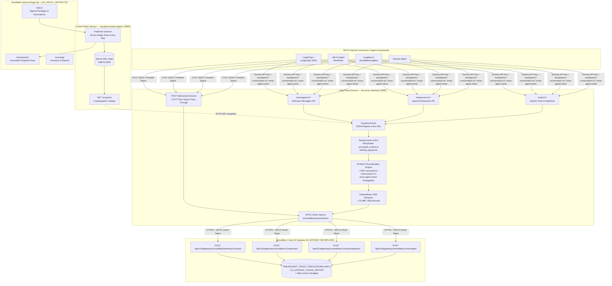
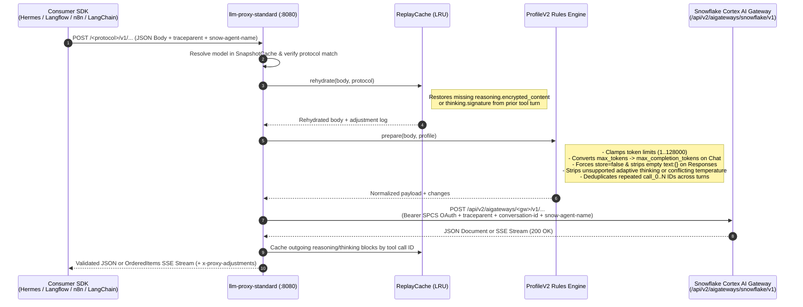
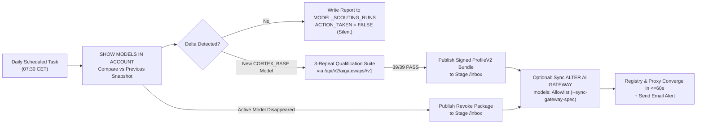

# Snowflake Cortex AI Gateway Proxy & Single-Writer Model Registry (`snowflake-proxy-cortex-aigateway`)

[](LICENSE)
[](pyproject.toml)
[](docs/ARCHITECTURE.md)
[](#8-running-the-offline-test-suite)

> [!WARNING]
> **Disclaimer — Non-Official Project**
> This repository is an **independent, open-source community and field-engineering reference implementation** built on top of **Snowflake Cortex AI Gateway** (`/api/v2/aigateways/<gateway>/v1`) and **Snowpark Container Services (SPCS)**.
> It is **NOT an official Snowflake product**, is **not** endorsed or supported by Snowflake Support, and is provided **"AS IS"** without warranty of any kind under the free and open-source **[MIT License](LICENSE)**.
> Always validate security, governance, and compliance requirements in your own Snowflake environment before deploying to production.

---

## Companion Repository Notice

This project is part of a **dual-track reference architecture** for Snowflake Cortex inference in SPCS:
- **[`snowflake-proxy-cortex-aigateway`](https://github.com/fbattaglieri-snowflake/snowflake-proxy-cortex-aigateway)** *(this repository)* — Routes inference through **Snowflake Cortex AI Gateway** (`/api/v2/aigateways/<gateway>/v1`) and adds W3C `traceparent` / `x-snowflake-ai-gateway-conversation-id` / `snow-agent-name` propagation, internal OTLP client trace pass-through (`POST /telemetry/v1/traces`), `TABLE(AGENT_TRACE_TABLE('<GATEWAY>'))` observability, `AI_GATEWAY_USAGE_HISTORY` cost attribution, per-user token quotas, and optional `ALTER AI GATEWAY` model allowlist synchronization.
- **[`snowflake-proxy-cortexrestapi`](https://github.com/fbattaglieri-snowflake/snowflake-proxy-cortexrestapi)** — Routes inference directly to the **Snowflake Cortex REST API** (`/api/v2/cortex/v1`) with the exact same `ProfileV2` normalization engine, `OrderedItems` SSE stream stabilizer, `ReplayCache` multi-turn rehydration, and autonomous daily scouting pipeline.

---

## Table of Contents

1. [Why Put This Proxy in Front of Snowflake Cortex AI Gateway?](#1-why-put-this-proxy-in-front-of-snowflake-cortex-ai-gateway)
2. [End-to-End Visual Architecture](#2-end-to-end-visual-architecture)
3. [Protocol & Telemetry Surface (`:8080` & `:8090`)](#3-protocol--telemetry-surface-8080--8090)
4. [Request Normalization, Streaming & Multi-Turn `ReplayCache` Pipeline](#4-request-normalization-streaming--multi-turn-replaycache-pipeline)
5. [Native OpenTelemetry, OTLP Client Spans & Governance in Cortex AI Gateway](#5-native-opentelemetry-otlp-client-spans--governance-in-cortex-ai-gateway)
6. [Autonomous Daily Model Scouting, Qualification & Zero-Touch Promotion](#6-autonomous-daily-model-scouting-qualification--zero-touch-promotion)
7. [Repository Structure](#7-repository-structure)
8. [Running the Offline Test Suite](#8-running-the-offline-test-suite)
9. [License & Disclaimer](#9-license--disclaimer)

---

## 1. Why Put This Proxy in Front of Snowflake Cortex AI Gateway?

**Snowflake Cortex AI Gateway** (`https://<account-host>/api/v2/aigateways/<gateway-name>`) provides account-level governance, OpenTelemetry server traces (`TABLE(AGENT_TRACE_TABLE('<GATEWAY>'))`), OTLP client trace ingestion (`/telemetry/v1/traces`), usage accounting (`AI_GATEWAY_USAGE_HISTORY`), per-user token quotas, and model allowlists.

However, when connecting standard agentic frameworks and workflow platforms (**Hermes Agent**, **Langflow**, **Native-Snowflake-Langflow**, **n8n**, **LangChain / LangGraph**) inside **Snowpark Container Services (SPCS)**, **Cortex AI Gateway alone is not sufficient**:

| Capability Gap on Raw Cortex AI Gateway | How `snowflake-proxy-cortex-aigateway` Solves It |
|---|---|
| **No `/v1/models` Discovery Endpoint** (`GET /api/v2/aigateways/snowflake/v1/models` returns `HTTP 404: Not a supported AI Gateway path`) | Exposes native `GET /chat/v1/models`, `GET /responses/v1/models`, and `GET /messages/v1/models` backed by the **Single-Writer Model Registry (`:8090`)**, returning only models qualified for each exact protocol. |
| **Strict Upstream Parameter Rejections (`HTTP 400`)** (`store=true` from n8n, `max_tokens` instead of `max_completion_tokens` on `openai-gpt-6-luna`, `reasoning_effort` mismatches, `temperature` alongside `thinking`, string `tool_choice="auto"` on Messages) | **`ProfileV2` Normalization Engine (`rules.py`)** transparently rewrites, clamps, or strips incompatible client options before forwarding to Cortex AI Gateway, recording every change in `x-proxy-adjustments`. |
| **Interleaved SSE Events on OpenAI Responses** (`response.output_item.added` with provisional/empty `encrypted_content`) | **`OrderedItems` Stream Stabilizer (`stream_order.py`)** serializes SSE output items, validates final `encrypted_content`, and backfills `response.output_item.added` so `langchain-openai`, `Langflow`, `Hermes`, and `n8n` never fail mid-stream. |
| **Stateless Clients Dropping `encrypted_content` or `thinking.signature`** on Multi-Turn Tool Loops | **In-Memory `ReplayCache` (`replay_cache.py`)** caches reasoning/thinking artifacts keyed by `call_id` / `tool_use_id` and rehydrates them automatically on subsequent tool-result turns. |
| **SPCS In-Container Authentication & OTLP Trace Export** | Reads the rotated SPCS OAuth token from `/snowflake/session/token`, injects `Authorization: Bearer <token>` + `X-Snowflake-Authorization-Token-Type: OAUTH` on both inference and `POST /telemetry/v1/traces`, and forwards W3C `traceparent`, `tracestate`, `x-snowflake-ai-gateway-conversation-id`, and `snow-agent-name`. |

---

## 2. End-to-End Visual Architecture

### 2.1 High-Level Component & Data-Flow Diagram (Mermaid)



### 2.2 ASCII Deployment Topology Inside Snowpark Container Services

```text
+---------------------------------------------------------------------------------------------------+
| SNOWFLAKE ACCOUNT (CORTEX_ENABLED_CROSS_REGION = 'ANY_REGION' + AI GATEWAY SNOWFLAKE)             |
|                                                                                                   |
|  +-----------------------+   +-----------------------+   +-----------------------+                |
|  |     Hermes Agent      |   |  Langflow / Native    |   |    n8n / LangChain    |                |
|  |  (3 Dynamic Providers)|   |  (Proxy Components)   |   |   (OpenAI/Anthropic)  |                |
|  +-----------+-----------+   +-----------+-----------+   +-----------+-----------+                |
|              |                           |                           |                            |
|              +---------------------------+---------------------------+                            |
|                                          |  Internal SPCS DNS (*.svc.spcs.internal:8080)          |
|                                          |  API Key: "internal-spcs" (never sent upstream)        |
|                                          v                                                        |
|  +---------------------------------------------------------------------------------------------+  |
|  |                  DATA-PLANE: llm-proxy-standard (:8080)                                     |  |
|  |                                                                                             |  |
|  |  [GET  /<protocol>/v1/models] ---------> Serves strictly qualified models from SnapshotCache|  |
|  |  [POST /chat/v1/chat/completions] -----> ReplayCache -> ProfileV2 Rules -> OrderedItems SSE |  |
|  |  [POST /responses/v1/responses] -------> Propagates traceparent, tracestate,                |  |
|  |  [POST /messages/v1/messages]            x-snowflake-ai-gateway-conversation-id,            |  |
|  |  [POST /telemetry/v1/traces] ----------> snow-agent-name + Injects /snowflake/session/token |  |
|  +--------------------+--------------------------------------------------+---------------------+  |
|                       | Polls /snapshot (30s)                            | HTTPS + SPCS OAuth     |
|                       v                                                  v                        |
|  +----------------------------------------+     +----------------------------------------------+  |
|  | CONTROL-PLANE:                         |     | SNOWFLAKE CORTEX AI GATEWAY                  |  |
|  | standard-model-registry (:8090)        |     | https://<host>/api/v2/aigateways/snowflake   |  |
|  |  - Single-Writer SQLite (PRAGMA FULL)  |     |  - /v1/messages                              |  |
|  |  - Scans Stage /inbox every 30s        |     |  - /v1/chat/completions                      |  |
|  |  - Verifies Trust & Floor Checkpoints  |     |  - /v1/responses                             |  |
|  +--------------------+-------------------+     |  - /telemetry/v1/traces (OTLP)               |  |
|                       ^                         |  - TABLE(AGENT_TRACE_TABLE('SNOWFLAKE'))     |  |
|                       | Stage Mount             |  - ACCOUNT_USAGE.AI_GATEWAY_USAGE_HISTORY    |  |
|  +--------------------+-------------------+     +----------------------------------------------+  |
|  | INTERNAL STAGE (@...ARTIFACTS)         |                                                       |
|  |  /inbox       /checkpoints  /scouting  | <--- Daily Scouting Task (07:30 CET)                  |
|  +----------------------------------------+      + Optional ALTER AI GATEWAY Allowlist Sync       |
+---------------------------------------------------------------------------------------------------+
```

---

## 3. Protocol & Telemetry Surface (`:8080` & `:8090`)

| Surface | Service Port | HTTP Method & Path | Upstream Cortex AI Gateway Target | Purpose |
|---|---|---|---|---|
| **OpenAI Chat Completions** | `:8080` | `GET /chat/v1/models`<br/>`GET /chat/v1/models/{id}`<br/>`POST /chat/v1/chat/completions` | `POST /api/v2/aigateways/<gw>/v1/chat/completions` | Native Chat Completions discovery & inference |
| **OpenAI Responses API** | `:8080` | `GET /responses/v1/models`<br/>`GET /responses/v1/models/{id}`<br/>`POST /responses/v1/responses` | `POST /api/v2/aigateways/<gw>/v1/responses` | Native Responses discovery, `OrderedItems` SSE & `encrypted_content` replay |
| **Anthropic Messages API** | `:8080` | `GET /messages/v1/models`<br/>`GET /messages/v1/models/{id}`<br/>`POST /messages/v1/messages` | `POST /api/v2/aigateways/<gw>/v1/messages` | Native Anthropic Messages discovery, extended thinking & signature replay |
| **OTLP Client Telemetry** | `:8080` | `POST /telemetry/v1/traces` | `POST /api/v2/aigateways/<gw>/telemetry/v1/traces` | Authenticated OTLP JSON/Protobuf client span ingestion (up to 1 MiB) |
| **Health & Readiness** | `:8080` | `GET /healthz`<br/>`GET /readyz` | Local check (SnapshotCache + SPCS token + drain state) | Container probes & active catalog `revision` inspection |
| **Model Registry Snapshot** | `:8090` | `GET /snapshot`<br/>`GET /readyz` | Local SQLite single-writer state | Signed catalog snapshot distribution to data-plane replicas |

---

## 4. Request Normalization, Streaming & Multi-Turn `ReplayCache` Pipeline



### Summary of Automatic Protocol Normalizations (`src/llm_proxy_standard/rules.py`)

| Protocol | Client Quirk / Incompatible Parameter | Automatic Proxy Action |
|---|---|---|
| **`chat`** | Client sends `max_tokens` alone (e.g. `openai-gpt-6-luna` rejects `max_tokens` with `HTTP 400`) | Automatically converts `max_tokens` &rarr; `max_completion_tokens` (`rename-max-tokens-to-completion`). |
| **`chat`** | Client sends both `max_tokens` and `max_completion_tokens` | Drops `max_tokens` and keeps `max_completion_tokens` (`dedup-max-tokens`). |
| **`chat`** | Model requires `reasoning_effort="none"` or forbids `reasoning_effort` | Forces `"none"` or strips `reasoning_effort` per the model's `ProfileV2` constraints. |
| **`responses`** | Client (e.g. n8n) sends `store: true`, `text: {}`, or `temperature` on reasoning models | Forces `store: false`, removes empty `text: {}`, strips unsupported `temperature`/`top_p`, and injects `include: ["reasoning.encrypted_content"]`. |
| **`responses`** | Streaming events arrive with provisional/empty `encrypted_content` on `output_item.added` | `OrderedItems` buffers per-item events, validates final `encrypted_content` equality, and backfills `output_item.added`. |
| **`messages`** | Client sends `thinking: {"type": "adaptive"}` on models supporting `["enabled", "disabled"]` | Strips unsupported `thinking` and `output_config` instead of failing with `HTTP 400`. |
| **`messages`** | Client enables `thinking` alongside `temperature` or with `max_tokens <= budget_tokens` | Strips `temperature`/`top_p` and raises `max_tokens = budget_tokens + 4096`. |
| **`messages`** | Client sends string `tool_choice: "auto"` instead of object | Rewrites to `{"type": "auto"}`. |
| **All Protocols** | Multi-round agent reuses `call_0` across closed turns | Renames duplicate IDs in subsequent turns (`call_0` &rarr; `call_0_r2`) in both assistant call and tool result. |

---

## 5. Native OpenTelemetry, OTLP Client Spans & Governance in Cortex AI Gateway

### 5.1 End-to-End Trace Correlation (`traceparent` + `conversation-id` + `snow-agent-name`)

When a consumer calls `llm-proxy-standard (:8080)`, the proxy validates and forwards:
- **`traceparent`** (`^00-[0-9a-f]{32}-[0-9a-f]{16}-[0-9a-f]{2}$`): W3C Trace Context ID linking client spans and Cortex AI Gateway server spans under a single `trace_id`.
- **`tracestate`**: W3C vendor trace state.
- **`x-snowflake-ai-gateway-conversation-id`** (also mapped automatically if the client sends `x-claude-code-session-id` or `x-conversation-id`): populates `attributes:"gen_ai.conversation.id"` in `AGENT_TRACE_TABLE`.
- **`snow-agent-name`**: populates `attributes:"http.request.header.snow-agent-name"` in `AGENT_TRACE_TABLE` for per-agent filtering (`hermes-agent`, `langflow-agent`, `n8n-workflow`, etc.).

### 5.2 Internal OTLP Client Trace Pass-Through (`POST /telemetry/v1/traces`)

Internal SPCS services do not need external PATs to export OpenTelemetry client spans (such as local tool execution latency, retrieval steps, or agent workflow spans). Point any standard OTLP HTTP exporter to:

```text
http://llm-proxy-standard.<namespace>.svc.spcs.internal:8080/telemetry/v1/traces
```

The proxy validates the OTLP payload (`application/json` or `application/x-protobuf`, up to `1 MiB`), attaches the SPCS OAuth token from `/snowflake/session/token`, and forwards it to `https://<account-host>/api/v2/aigateways/<gateway>/telemetry/v1/traces`.

### 5.3 Querying Joined Client & Server Spans in Snowflake

```sql
SELECT
  TIMESTAMP,
  TRACE:"trace_id"::STRING AS TRACE_ID,
  RECORD:"name"::STRING AS SPAN_NAME,
  SCOPE:"name"::STRING AS SCOPE_NAME,
  RECORD_ATTRIBUTES:"gen_ai.request.model"::STRING AS MODEL,
  RECORD_ATTRIBUTES:"gen_ai.conversation.id"::STRING AS CONVERSATION_ID,
  RECORD_ATTRIBUTES:"http.request.header.snow-agent-name"::STRING AS AGENT_NAME,
  RECORD_ATTRIBUTES:"gen_ai.usage.input_tokens"::INT AS INPUT_TOKENS,
  RECORD_ATTRIBUTES:"gen_ai.usage.output_tokens"::INT AS OUTPUT_TOKENS,
  RESOURCE_ATTRIBUTES:"user"::STRING AS CALLER_IDENTITY
FROM TABLE(AGENT_TRACE_TABLE('SNOWFLAKE'))
WHERE RECORD_TYPE = 'SPAN'
  AND TIMESTAMP >= DATEADD('hour', -24, CURRENT_TIMESTAMP())
ORDER BY TIMESTAMP DESC;
```

### 5.4 Usage Accounting, Per-User Token Quotas & Gateway Specification

```sql
-- 1. Hourly token & request usage by model and SPCS service/user
SELECT
  START_TIME,
  END_TIME,
  GATEWAY_NAME,
  MODEL_NAME,
  USER_ID,
  REQUEST_COUNT,
  INPUT_TOKENS,
  OUTPUT_TOKENS
FROM SNOWFLAKE.ACCOUNT_USAGE.AI_GATEWAY_USAGE_HISTORY
ORDER BY START_TIME DESC;

-- 2. Configure Gateway logging, per-user quotas, and model allowlist
ALTER AI GATEWAY SNOWFLAKE FROM SPECIFICATION
$$
api_version: v1
logging:
  input: true
  output: true
rate_limits:
  - scope: per_user
    tokens: 5000000
    window: daily
models:
  - claude-opus-5-5
  - claude-sonnet-5-5
  - openai-gpt-6-astra
  - openai-gpt-6.1-terra
  - grok-4.7
  - kimi-k3
$$;
```

---

## 6. Autonomous Daily Model Scouting, Qualification & Zero-Touch Promotion



See **[`docs/PROMOTION.md`](docs/PROMOTION.md)** for full instructions on running `scripts/daily_scout_and_promote.py`, `scripts/promote_model.py`, and `scripts/spcs_scout_worker.py`.

---

## 7. Repository Structure

```text
snowflake-proxy-cortex-aigateway/
├── Dockerfile                              # Hardened non-root container image (port 8080)
├── LICENSE                                 # MIT License + Non-Official Disclaimer
├── README.md                               # Architecture, visual diagrams, observability & usage
├── pyproject.toml                          # Python package metadata & pinned dependencies
├── requirements.runtime.lock               # Locked runtime dependencies
├── deployment/
│   ├── service-spec.yaml.template          # SPCS service specification template (Gateway mode)
│   └── setup_daily_scout_task.sql.template # Snowflake DDL for autonomous daily scouting task
├── docs/
│   ├── ARCHITECTURE.md                     # Deep-dive on protocol normalization, Gateway headers & OTLP
│   ├── CONSUMERS.md                        # Client setup for Hermes, Langflow, n8n, LangChain + OTLP
│   └── PROMOTION.md                        # Zero-touch promotion, revocation & Gateway spec sync
├── examples/
│   └── standard_clients.py                 # Ready-to-run OpenAI, Anthropic, and LangChain client helpers
├── scripts/
│   ├── promote_model.py                    # Zero-touch model promotion & revocation CLI
│   ├── daily_scout_and_promote.py          # Daily account snapshot diff, qualification & Gateway spec sync
│   └── spcs_scout_worker.py                # In-container SPCS scouting job worker
├── src/
│   ├── llm_proxy_standard/                 # Core proxy (:8080) & Single-Writer Registry (:8090)
│   │   ├── app.py                          # FastAPI data-plane + Gateway headers + /telemetry/v1/traces
│   │   ├── rules.py                        # ProfileV2 option normalization & conflict resolution
│   │   ├── protocol.py                     # Native SSE & JSON validators across 3 protocols
│   │   ├── stream_order.py                 # OrderedItems SSE item serializer for Responses
│   │   ├── replay_cache.py                 # Stateless multi-turn reasoning/thinking rehydration
│   │   ├── registry.py                     # Cryptographic & administrative trust verification
│   │   ├── registry_service.py             # Single-writer Registry HTTP service (:8090)
│   │   └── publisher.py                    # Stage /inbox scanner & floor checkpoint verifier
│   └── model_probe/                        # 39-check live qualification campaign runner
└── tests/                                  # 93 offline unit & integration tests (zero network needed)
```

---

## 8. Running the Offline Test Suite

All **93 unit and integration tests** run completely offline using synthetic Ed25519 authorities and mock transports (no Snowflake credentials or network access required):

```bash
PYTHONPATH=src:scripts:. python -m unittest discover -s tests -t .
```

---

## 9. License & Disclaimer

Released under the **[MIT License](LICENSE)**.

This software is an independent community / field-engineering project and is **not** an official Snowflake product or offering. All Snowflake, Cortex, OpenAI, Anthropic, LangChain, Langflow, Hermes, and n8n trademarks belong to their respective owners.
